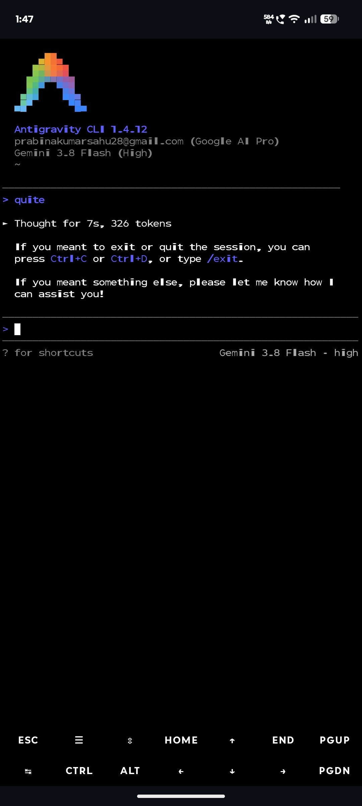

# Google Antigravity CLI (`agy`) on Android via Termux

[](LICENSE)
[](https://www.android.com/)
[](https://termux.dev/)
[-blue)](#2-system-requirements)
[](#6-screenshots-and-visual-guide)

A beginner-friendly, step-by-step installation and setup guide for running **Google Antigravity CLI (`agy`)** natively inside **Termux** on Android devices.

---

## Table of Contents

- [1. Project Introduction](#1-project-introduction)
  - [What is AGY?](#what-is-agy)
  - [Who Should Use It?](#who-should-use-it)
  - [Key Features](#key-features)
  - [Visual Preview](#visual-preview)
- [2. System Requirements](#2-system-requirements)
- [3. Download & Install Termux](#3-download--install-termux)
  - [Why You Must Avoid the Google Play Store](#why-you-must-avoid-the-google-play-store)
  - [Official Download Links](#official-download-links)
  - [Installing and Opening Termux](#installing-and-opening-termux)
- [4. Step-by-Step AGY Installation](#4-step-by-step-agy-installation)
  - [Step 1: Check Your Device Architecture](#step-1-check-your-device-architecture)
  - [Step 2: Grant Storage Access (Recommended)](#step-2-grant-storage-access-recommended)
  - [Step 3: Update Termux Packages](#step-3-update-termux-packages)
  - [Step 4: Install Required Base Packages](#step-4-install-required-base-packages)
  - [Step 5: Enable the GLIBC Repository](#step-5-enable-the-glibc-repository)
  - [Step 6: Refresh Package Index](#step-6-refresh-package-index)
  - [Step 7: Install GLIBC Runtime](#step-7-install-glibc-runtime)
  - [Step 8: Run the AGY Installer](#step-8-run-the-agy-installer)
  - [Step 9: Verify the Installation](#step-9-verify-the-installation)
  - [Step 10: Start Antigravity CLI](#step-10-start-antigravity-cli)
- [5. First-Time Setup & Everyday Usage](#5-first-time-setup--everyday-usage)
  - [Google Account Authentication](#google-account-authentication)
  - [Starting a Project Session](#starting-a-project-session)
  - [Useful Commands and Shortcuts](#useful-commands-and-shortcuts)
- [6. Screenshots and Visual Guide](#6-screenshots-and-visual-guide)
- [7. Troubleshooting](#7-troubleshooting)
  - [Error 1: Unable to locate package glibc-repo](#error-1-unable-to-locate-package-glibc-repo)
  - [Error 2: Missing Termux GLIBC loader](#error-2-missing-termux-glibc-loader)
  - [Error 3: Missing CA bundle or resolver configuration](#error-3-missing-ca-bundle-or-resolver-configuration)
  - [Error 4: CPU does not support LSE atomics](#error-4-cpu-does-not-support-lse-atomics)
  - [Error 5: agy: command not found](#error-5-agy-command-not-found)
  - [Error 6: Browser authentication page fails to open](#error-6-browser-authentication-page-fails-to-open)
  - [Error 7: Package repository network failures](#error-7-package-repository-network-failures)
- [8. Frequently Asked Questions (FAQ)](#8-frequently-asked-questions-faq)
- [9. Support, Links & Credits](#9-support-links--credits)

---

## 1. Project Introduction

### What is AGY?

**Google Antigravity CLI (`agy`)** is Google's terminal-based AI coding assistant. It acts as an autonomous pair programmer inside your terminal: it can understand code, read and write project files, execute shell commands, plan multi-step implementations, and help you build software using models such as **Gemini 3.8 Flash** and **Gemini Pro**.

While Google officially packages AGY for desktop Linux, macOS, and Windows, the open-source community created a native standalone port ([wallentx/antigravity-cli-termux](https://github.com/wallentx/antigravity-cli-termux)) that bundles the necessary GLIBC loader to run directly inside **Termux on Android**.

### Who Should Use It?

- **Mobile Developers & Students:** Code, experiment, and debug full projects on your Android phone or tablet without needing a laptop.
- **Power Users:** Automate scripts, inspect repositories, and refactor code on the go.
- **AI Enthusiasts:** Experience agentic coding directly from a portable terminal environment.

### Key Features

- **Full Terminal Coding Agent:** Generates code, inspects folder structures, creates files, and runs terminal commands interactively.
- **Powered by Gemini Models:** Connects to Google AI services (e.g., Google AI Pro, Google Workspace, Gemini models).
- **Native Termux Speed:** Runs directly inside Termux with a lightweight GLIBC compatibility layer—no heavy Linux GUI or full virtual machine needed.
- **Twin Binary Architecture:** Includes `agy` and `agy.va39` binaries optimized for ARM64 virtual address handling.
- **Built-in Self Updater:** Easily update AGY anytime by running `agy update`.

### Visual Preview

Here is AGY CLI 1.4.12 running smoothly inside Termux on an Android smartphone:

<p align="center">
  
</p>

---

## 2. System Requirements

Before you begin, verify that your Android device satisfies the minimum requirements:

| Requirement | Minimum / Supported Spec | Notes |
| :--- | :--- | :--- |
| **Operating System** | Android 7.0 (Nougat) or newer | Android 10+ recommended for best terminal stability |
| **CPU Architecture** | 64-bit ARM (`aarch64` / `arm64-v8a`) | 32-bit (`armeabi-v7a`) is **not** supported |
| **Termux App** | **v0.118.3** or newer (from GitHub or F-Droid) | **Never** use Google Play Store version |
| **Available Storage** | Minimum **500 MB** free internal storage | ~1 GB recommended for caching and projects |
| **Internet Access** | Stable Wi-Fi or mobile data | Required for downloading packages and Gemini API |
| **Google Account** | Personal Google Account or Google AI Pro | Required for one-time browser sign-in |
| **Root Access** | **Not required** (works on standard, unrooted devices) | Runs in Termux user space |

---

## 3. Download & Install Termux

> [!CAUTION]
> ### Why You Must Avoid the Google Play Store
> The Termux build published on the Google Play Store is **completely deprecated and broken**. Due to Android SDK targeting restrictions, Play Store updates ceased at version 0.79 in 2020. Running `pkg update` on the Play Store build will fail with repository errors.
>
> If you already have Termux installed from Google Play:
> 1. Open Android **Settings** → **Apps** → **Termux**.
> 2. Tap **Uninstall** (note: this removes files inside Termux).
> 3. Install the official GitHub or F-Droid build below.

### Official Download Links

Always download Termux from official, verified release channels:

| Source | Download Link | File Name / Notes |
| :--- | :--- | :--- |
| **Official GitHub (Direct APK)** | [Download Termux v0.118.3 APK (arm64-v8a)](https://github.com/termux/termux-app/releases/download/v0.118.3/termux-app_v0.118.3%2Bgithub-debug_arm64-v8a.apk) | Direct APK for 64-bit ARM devices (Recommended) |
| **GitHub Releases Page** | [Termux Releases on GitHub](https://github.com/termux/termux-app/releases/latest) | Browse all release assets and changelogs |
| **F-Droid Store** | [Termux on F-Droid](https://f-droid.org/packages/com.termux/) | Open-source alternative app store |

### Installing and Opening Termux

1. **Download the APK:** Tap the [Direct APK download link](https://github.com/termux/termux-app/releases/download/v0.118.3/termux-app_v0.118.3%2Bgithub-debug_arm64-v8a.apk) above on your Android phone.
2. **Install APK:** Open the downloaded `.apk` file from your browser or file manager.
   - If prompted by Android with *"For your security, your phone is not allowed to install unknown apps from this source"*, tap **Settings** and enable **Allow from this source**.
3. **Launch Termux:** Tap **Open** when installation finishes.
4. **First Bootstrap:** Allow Termux a few seconds on its first launch to extract its bootstrap packages until the standard `$` command prompt appears.

---

## 4. Step-by-Step AGY Installation

Open the **Termux** app on your Android device. Follow these steps in order. Each command is provided in its own code block so you can easily copy and paste it into Termux.

### Step 1: Check Your Device Architecture

Verify that your phone has a 64-bit ARM processor:

```bash
uname -m
```

**Expected output:**
```text
aarch64
```

> [!IMPORTANT]
> If your output displays `armv7l`, `i686`, or `x86_64`, your device does not have an `aarch64` processor. The AGY installer will not proceed on unsupported architectures.

---

### Step 2: Grant Storage Access (Recommended)

Allow Termux to access your phone's internal storage (`/sdcard`) so you can open projects stored on your device:

```bash
termux-setup-storage
```

**Action required:** Android will show a permission popup asking: *"Allow Termux to access photos, media, and files on your device?"* Tap **Allow**.

---

### Step 3: Update Termux Packages

Refresh the Termux package index and upgrade all base system packages to their latest versions:

```bash
pkg update && pkg upgrade -y
```

> [!TIP]
> If Termux asks you questions regarding modified configuration files during the upgrade (e.g. `keep the local version [default=N]?`), press **Enter** to accept the default option.

---

### Step 4: Install Required Base Packages

Install the download manager (`curl`), archive extractor (`tar`), trusted SSL/TLS certificates (`ca-certificates`), and DNS resolver helper (`resolv-conf`):

```bash
pkg install -y curl tar ca-certificates resolv-conf
```

---

### Step 5: Enable the GLIBC Repository

Google Antigravity is compiled against GNU C Library (GLIBC). Native Termux uses Android's Bionic libc, so we enable the community GLIBC package repository:

```bash
pkg install -y glibc-repo
```

---

### Step 6: Refresh Package Index

Update the package lists so Termux can find the newly added GLIBC packages:

```bash
pkg update
```

---

### Step 7: Install GLIBC Runtime

Install the GLIBC runtime and dynamic loader (`ld-linux-aarch64.so.1`):

```bash
pkg install -y glibc
```

---

### Step 8: Run the AGY Installer

Download and run the community AGY standalone installer script:

```bash
curl -fsSL https://raw.githubusercontent.com/wallentx/antigravity-cli-termux/dev/install.sh | bash
```

**What the installer does automatically:**
1. Validates native Termux environment and `aarch64` architecture.
2. Checks for required certificates, DNS resolver, and GLIBC loader.
3. Tests hardware support for LSE atomics.
4. Downloads the `antigravity-termux-standalone.tar.gz` archive.
5. Extracts and installs `agy` and `agy.va39` into `$PREFIX/bin`.
6. Sets execution permissions and verifies the engine.

---

### Step 9: Verify the Installation

Confirm that the `agy` command is properly installed and accessible:

```bash
agy --version
```

**Expected output:**
```text
Antigravity CLI 1.4.12
```
*(or a newer version number)*

---

### Step 10: Start Antigravity CLI

Launch the interactive Antigravity CLI:

```bash
agy
```

---

## 5. First-Time Setup & Everyday Usage

### Google Account Authentication

On the first launch of `agy`, you must link your Google Account:

1. AGY will generate a secure authentication link and attempt to launch your Android web browser (such as Google Chrome, Brave, or Firefox).
2. Sign in with your Google Account that has access to Gemini / Antigravity services (e.g., Google AI Pro or standard account).
3. Authorize the CLI session.
4. Return to the Termux app. Once authorized, the colorful pixelated **A** logo and interactive prompt will appear!

> [!NOTE]
> If your browser does not open automatically, look at the terminal screen. AGY will print an authentication URL starting with `https://...`. Long-press the URL to copy it, open it in your browser, sign in, and return to Termux.

### Starting a Project Session

AGY works with the files inside the folder where you launch it. To start pair programming on a specific project:

```bash
# 1. Create or navigate to your project directory
mkdir -p ~/projects/my-app
cd ~/projects/my-app

# 2. Launch AGY inside this directory
agy
```

Now you can chat with the assistant in plain English:
- *"Create a simple HTTP server in Python with a health-check endpoint."*
- *"Inspect package.json and write the unit tests for the authentication module."*
- *"Explain the project structure and list any missing dependencies."*

### Useful Commands and Shortcuts

| Action | Command / Shortcut | Description |
| :--- | :--- | :--- |
| **Exit AGY** | `/exit` or `Ctrl+D` | Exits the active AGY session (tap `CTRL` on Termux toolbar, then `d`) |
| **Help Menu** | `/help` or `?` | Displays in-CLI slash commands, flags, and shortcuts |
| **Clear Screen** | `/clear` | Clears the active chat buffer |
| **Update AGY** | `agy update` | Checks for and installs the latest Termux standalone release |
| **Check Version** | `agy --version` | Prints the installed CLI release version |

---

## 6. Screenshots and Visual Guide

### Live Running Interface

The screenshot below illustrates a genuine live session of Antigravity CLI 1.4.12 running inside Termux on an Android device:

<p align="center">
  
</p>

**Key Interface Elements:**
- **Antigravity Logo & Version:** Displays the colorful pixelated logo, release version (`1.4.12`), and connected account email (`Google AI Pro`).
- **Active AI Model:** Shows the current model (`Gemini 3.8 Flash (High)`).
- **Thinking & Token Counter:** Reports reasoning duration and token usage (e.g., `Thought for 7s, 326 tokens`).
- **Input Prompt (`>`):** Type natural language coding prompts directly into the terminal.
- **Termux Extra Keys Bar:** The toolbar at the bottom provides essential keyboard buttons (`ESC`, `CTRL`, `ALT`, `HOME`, `END`, arrows) for easy mobile navigation.

> [!NOTE]
> *Screenshot Transparency:* The screenshot above is captured directly from an Android 64-bit device running Termux. All terminal commands and installation steps in this guide have been verified against the live installer script and Termux package repositories.

---

## 7. Troubleshooting

If you run into an issue, consult the verified solutions below:

### Error 1: Unable to locate package glibc-repo

- **Cause:** You are either using the outdated Google Play Store build of Termux, or your current Termux mirror is unresponsive.
- **Solution:**
  1. Ensure you installed Termux from [GitHub Releases](#official-download-links) or F-Droid.
  2. Change to a healthy repository mirror:
     ```bash
     termux-change-repo
     ```
     Select **Main repository** → choose a fast mirror (such as *Grimler* or *Tsinghua*) → tap **OK**.
  3. Re-run:
     ```bash
     pkg update
     pkg install -y glibc-repo
     ```

---

### Error 2: Missing Termux GLIBC loader

- **Error message:** `Missing Termux glibc loader: /data/data/com.termux/files/usr/glibc/lib/ld-linux-aarch64.so.1`
- **Cause:** The `glibc` package failed to download or was skipped.
- **Solution:** Install the repository package and the runtime package:
  ```bash
  pkg install -y glibc-repo
  pkg update
  pkg install -y glibc
  ```
  Then re-run the AGY installer script.

---

### Error 3: Missing CA bundle or resolver configuration

- **Error message:** `Missing Termux CA bundle: .../etc/tls/cert.pem` or `Missing Termux resolver configuration`
- **Cause:** Termux cannot establish trusted HTTPS handshakes or resolve hostnames without these packages.
- **Solution:** Run:
  ```bash
  pkg install -y ca-certificates resolv-conf
  ```

---

### Error 4: CPU does not support LSE atomics

- **Error message:** `This CPU does not support LSE atomics, and qemu-aarch64 was not found`
- **Cause:** Older ARMv8.0 processors (e.g. Cortex-A53) lack Large System Extensions (LSE) atomic instructions required by the V8 JavaScript engine in AGY.
- **Solution:** Install the user-mode QEMU emulator to emulate the missing instructions:
  ```bash
  pkg install -y qemu-user-aarch64
  ```
  After this command completes, re-run the AGY installer script.

---

### Error 5: agy: command not found

- **Cause:** The binary was installed to `$PREFIX/bin`, but your active shell has not refreshed its command path cache.
- **Solution:**
  1. Restart the Termux app (swipe it away from recent apps and open it again).
  2. Alternatively, reload your `$PATH` manually:
     ```bash
     export PATH="$PREFIX/bin:$PATH"
     agy --version
     ```

---

### Error 6: Browser authentication page fails to open

- **Cause:** Termux does not have permission to launch external Android intents or `termux-open-url` is missing.
- **Solution:** Look at the terminal output. Antigravity CLI prints the full URL. Long-press to copy the URL, paste it into Chrome or Firefox on your phone, sign in, and return to Termux.

---

### Error 7: Package repository network failures

- **Error message:** `Connection failed [IP: ...] 403 Forbidden` or `Repository under maintenance`
- **Cause:** Temporary downtime of the default Termux mirror.
- **Solution:** Run `termux-change-repo` and switch to a different mirror, then run `pkg update`.

---

## 8. Frequently Asked Questions (FAQ)

### How do I update AGY to the latest version?
The community port includes a built-in updater. In Termux, run:
```bash
agy update
```
To keep your underlying Termux packages updated as well:
```bash
pkg update && pkg upgrade -y
```

### How do I completely uninstall or reinstall AGY?
To remove the AGY binaries:
```bash
rm -f $PREFIX/bin/agy $PREFIX/bin/agy.va39
```
To reinstall fresh, simply run the installer command again:
```bash
curl -fsSL https://raw.githubusercontent.com/wallentx/antigravity-cli-termux/dev/install.sh | bash
```

### Can I install AGY on 32-bit Android devices?
No. The AGY engine and GLIBC bindings require 64-bit ARM (`aarch64`). Devices running 32-bit ARM (`armeabi-v7a`) or 32-bit x86 are not supported by this standalone port.

### Does this require a PRoot Linux container (Ubuntu / Debian)?
No! This guide installs AGY **natively in Termux** using the GLIBC runtime layer.
> [!NOTE]
> If you prefer running a full PRoot Linux distribution (e.g., Ubuntu via `proot-distro`), you do not need this Termux port. In PRoot, you can install Google's official Linux binary directly:
> ```bash
> curl -fsSL https://antigravity.google/cli/install.sh | bash
> ```

### Does AGY require phone rooting?
No. AGY and Termux run entirely in standard Android user space. Rooting (`su` / Magisk / KernelSU) is neither required nor recommended.

---

## 9. Support, Links & Credits

- **Target Repository & Guide:** [dev-prabina/agy-install-guide](https://github.com/dev-prabina/agy-install-guide)
- **AGY Termux Standalone Port:** [wallentx/antigravity-cli-termux](https://github.com/wallentx/antigravity-cli-termux)
- **Official Google Antigravity Home:** [antigravity.google](https://antigravity.google/)
- **Official Termux Project:** [termux/termux-app](https://github.com/termux/termux-app)
- **Termux GLIBC Packages:** [termux/glibc-packages](https://github.com/termux/glibc-packages)

### Reporting Issues

If you encounter issues during installation:
1. Double-check each step in [Section 4](#4-step-by-step-agy-installation).
2. Check the solutions in [Section 7 (Troubleshooting)](#7-troubleshooting).
3. If an issue persists, open an issue on the [Issue Tracker](https://github.com/dev-prabina/agy-install-guide/issues).

---

<p align="center">
  <b>Built with ❤️ for the mobile developer community.</b><br />
  Happy coding with Google Antigravity on Android!
</p>
